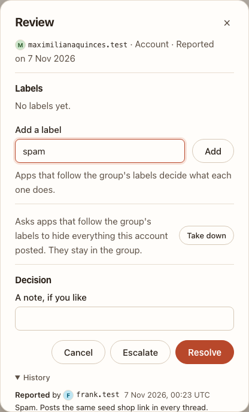
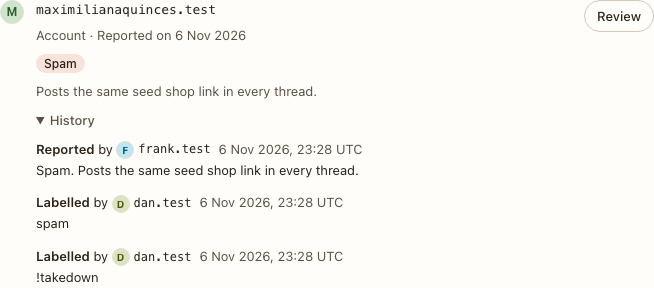
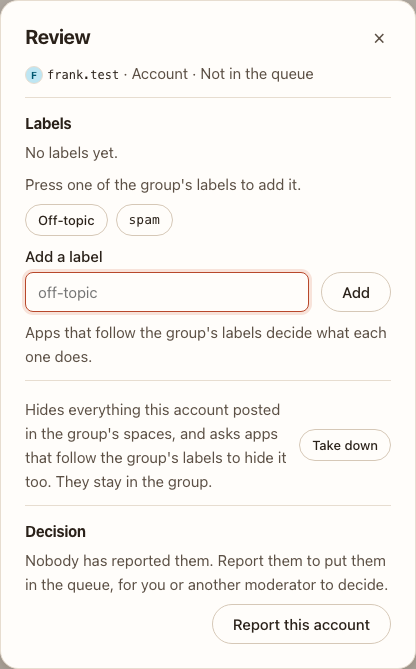

# Moderating

This guide shows you how to handle what members report in your group.
You read the reports, label or take down an account, remove someone from
the group, and close the report.

## Before you begin

You need a role in the group that lets you see the moderation queue. If
you started the group, your admin role already does everything here.

## Who can moderate, and where?

Moderation happens on the group's Moderation page. A member sees the way
there only when one of their roles lets them read the moderation queue.

1. Open your group in the console. If you may moderate, its card has
   **Moderation** at the top right, beside **Settings** if you are an
   admin.

   <!-- look /g/gardens.groups.test --as dan --seed moderating --element .group-card -->
   

2. Press **Moderation**. The page opens on its **Open** tab.

A member without the role does not see the button, and if they open the
page anyway it tells them there is nothing there for them. Each part of
the page needs its own permission in a role. It takes `mod.read` to see
the queue, `mod.resolve` to resolve or escalate, `label` to label
someone, and `takedown` to take an account down. You give these to a role as in
[Rules and roles](rules-and-roles.md).

## How does something come to be reported?

A report is a member flagging a post or an account to the group's
moderators. Members report from the apps they use in the group, not from
the console. Each report lands on this page, with the reason the member
chose and what they wrote. A member can report an account only while it
is in the group, and a post only in a part of the group they can read.

## What is on the Moderation page?

1. Look at the **Open** tab. Each row is one subject: an account, or a
   post that was reported, under the handle of the account that posted
   it. Under the handle, whether it is an account or a post and when it
   was reported, then the reasons members chose, then what the latest
   report said.

   <!-- look /g/gardens.groups.test/moderation --as dan --element main -->
   

2. Press **History** under a row to see everything that happened to it,
   oldest first: each report, label, escalation or resolution, who did
   it, when, and what they wrote.

The tabs sort subjects by where they are:

- **Open**: reported and not yet dealt with.
- **Escalated**: passed on, for someone else in the group to decide.
- **Resolved**: dealt with. A new report on a resolved subject puts it
  back in **Open**.

Nothing tells anyone when a subject moves. Whoever moderates looks at
the tabs.

## How do I pass a report on?

When a report is not yours to decide, escalate it.

1. Press **Review** on the post's row. The dialog **Review** opens, with
   everything you can do about the post and its history.
2. Under **Decision**, in **A note, if you like**, type why, such as
   "Third time this month; over to the admins."
3. Press **Escalate**. The dialog closes, and the subject leaves the
   **Open** tab.

   <!-- look /g/gardens.groups.test/moderation --as frank --click 'li.subject:has(> .row-main .who:text-is("frank.test")) > .row-actions button' --type ':popover-open [name=note]=Third time this month; over to the admins.' --click ':popover-open button[value=escalated]' --element main -->
   

The post now waits on the **Escalated** tab, your note in its history.

## How do I label an account?

A label is a tag the group puts on an account, such as "spam". Apps that
follow the group's labels decide what to do with it. Any word is yours to
choose, but two mean more: `!takedown` and `!hide`, which the next part
shows.

1. Press **Review** on the account's row.
2. Under **Add a label**, type the label, such as "spam".

   <!-- look /g/gardens.groups.test/moderation --as dan --click 'li.subject:has(> .row-main .who:text-is("maximilianaquinces.test")) > .row-actions button' --type ':popover-open input[name=val]:not([type=hidden])=spam' --element ':popover-open' -->
   

3. Press **Add**. The dialog stays open, and the label shows under
   **Labels**, with a × beside it.

   <!-- look /g/gardens.groups.test/moderation --as dan --click 'li.subject:has(> .row-main .who:text-is("maximilianaquinces.test")) > .row-actions button' --type ':popover-open input[name=val]:not([type=hidden])=spam' --click ':popover-open .row-form button[type=submit]' --element ':popover-open .review-part' -->
   

Press the × to take a label back. Once the group has used a label, the
dialog offers it to add with one press, under the field.

A post is labelled the same way, from its own Review, when the report
named the version of the post it was about. If it didn't, its Review says
so, and you label it from a terminal, as the last part shows.

## How do I take an account down?

A takedown asks apps to hide what an account posted. The host writes
the label `!takedown` but hides nothing itself. Apps that follow the
group's labels do the hiding. The account stays in the group until you
remove it, as the next part shows.

The dialog shows **Take down** only to a role with `takedown`.

1. In the account's Review, press **Take down**, beside the line on
   what a takedown does.
2. Press **Take down** again in the dialog that asks you to be sure.

   <!-- look /g/gardens.groups.test/moderation --as dan --click 'li.subject:has(> .row-main .who:text-is("maximilianaquinces.test")) > .row-actions button' --click ':popover-open button[popovertarget$=takedown]' --click '[id$=-takedown]:popover-open button[type=submit]' --element ':popover-open .review-part' -->
   

The label `!takedown` shows under **Labels**. Press its × to undo the
takedown. The label `!hide` works the same way: type it under **Add a
label**. Both need the same permission.

## How do I act on someone nobody reported?

You can label, take down or report anyone in the group, reported or not.

1. Under **Find an account**, at the top of the queue, type their
   handle, such as "frank.test".
2. Press **Review** beside it. Their Review opens. If nobody has reported them, it
   says **Not in the queue**, and in place of a decision it offers
   **Report this account**.

   <!-- look /g/gardens.groups.test/moderation --as dan --type '#find-handle=frank.test' --click 'form.find button[type=submit]' --element ':popover-open' -->
   

To put them in the queue for you or another moderator to decide, press
**Report this account**, choose why, and send the report. They go into the **Open**
tab with your report, as a member's report would.

## How do I remove someone from the group?

Removing takes away their membership. It does not hide what they posted;
a takedown does that.

1. Press **← Garden share** at the top of the page to go back to the
   group's page. In your group, the link shows your group's name.
2. In the members list, press the ⋯ at the end of the member's row, then
   **Remove from the group**.

   <!-- look /g/gardens.groups.test --as dan --click 'li.member:has-text("maximilianaquinces.test") .action-menu summary' --click 'li.member:has-text("maximilianaquinces.test") .menu button:has-text("Remove from the group")' --element ':popover-open' -->
   

3. Press **Remove** in the dialog **Remove this member?**. The member
   leaves the list, and its count goes down by one.

   <!-- look /g/gardens.groups.test --as dan --click 'li.member:has-text("maximilianaquinces.test") .action-menu summary' --click 'li.member:has-text("maximilianaquinces.test") .menu button:has-text("Remove from the group")' --click ':popover-open button[type=submit]' --element 'section:has(.member) .section-head' -->
   

They lose access to what only members see, and their history on the
Moderation page notes that they were removed. Removing does not block them:
they can ask to join again.

## How do I resolve a report?

1. On the Moderation page, press **Review** on the account's row.
2. Under **Decision**, in **A note, if you like**, type what was done,
   such as "Taken down and removed from the group."

   <!-- look /g/gardens.groups.test/moderation --as dan --click 'li.subject:has(> .row-main .who:text-is("maximilianaquinces.test")) > .row-actions button' --type ':popover-open [name=note]=Taken down and removed from the group.' --element ':popover-open .review-part:has([name=note])' -->
   

3. Press **Resolve**. The subject moves to the **Resolved** tab, with
   all that was done and your note in its history.

From **Resolved**, the row's **Review** can still escalate a subject.

## From a terminal

Each act here has a command in [the `opensocial` command](../reference/cli.md):

- Read the queue: `opensocial mod list gardens.groups.test --status open`,
  or `escalated` or `resolved`.
- Read one subject's history, with who did each thing:
  `opensocial mod history gardens.groups.test <did or at:// uri>`.
- Escalate or resolve: `opensocial mod resolve gardens.groups.test <subject> --status escalated --note "…"`,
  or `--status resolved`.
- Label an account: `opensocial mod label gardens.groups.test <did> spam`.
  A takedown is the same with `!takedown`.
- Label a post: `opensocial mod label gardens.groups.test <at:// uri> <label> --cid <cid>`.
- Take a label back: the same command with `--undo`.
- Remove a member: `opensocial member eject gardens.groups.test maximilianaquinces.test`.

No command makes a report. An AI app connected to the group has the same
acts as tools, listed in [the MCP reference](../reference/mcp.md).

Next, give moderators a role of their own in
[Rules and roles](rules-and-roles.md), or read
[how moderation works](../design/moderation.md).
