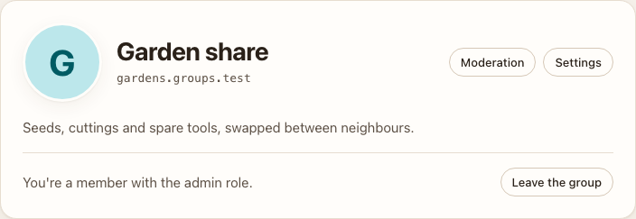
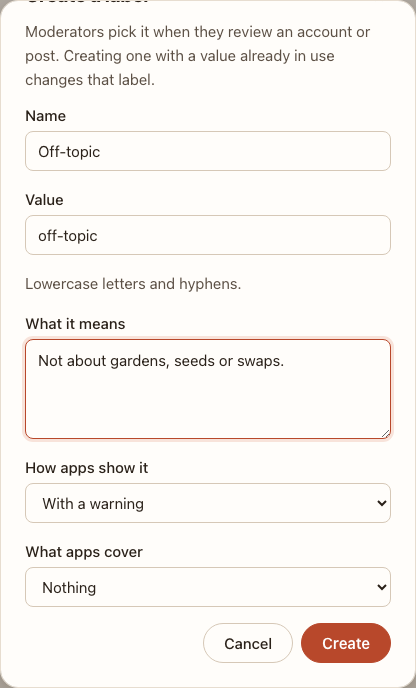
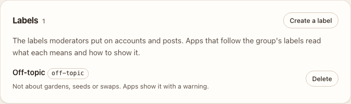
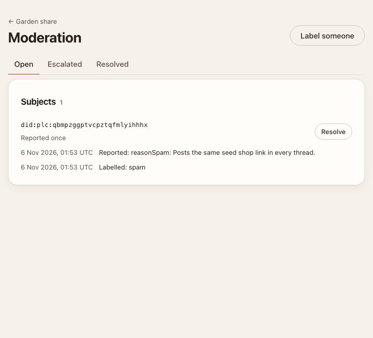
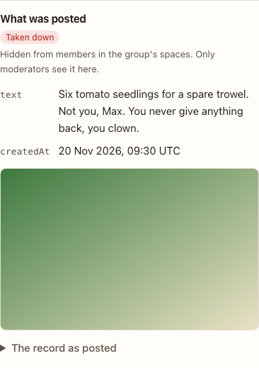
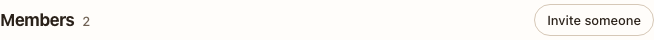

# Moderating

This guide shows you how to handle what members report in your group.
You read the reports, label or take down an account, remove someone from
the group, and close the report.

## Before you begin

You need a role in the group that lets you see the moderation queue. If
you started the group, your admin role already does everything here.

## Who can moderate, and where?

Moderation happens on the group's Moderation page. A member sees the way
there only when one of their roles lets them read the moderation queue.

1. Open your group in the console. If you may moderate, its card has
   **Moderation** at the top right, beside **Settings** if you're an
   admin.

   <!-- look /g/gardens.groups.test --as dan --seed moderating --element .group-card -->
   

2. Press **Moderation**. The page opens on its **Open** tab.

A member without the role doesn't see the button. If they open the page
anyway, it tells them there's nothing there for them. Each part of the
page needs its own permission in a role. It takes `mod.read` to see the
queue, `mod.resolve` to resolve or escalate, and `label` to label
someone or take an account down. You give these to a role as in
[Rules and roles](rules-and-roles.md).

## How does something come to be reported?

A report is a member flagging a post or an account to the group's
moderators. Members report from the apps they use in the group, and
they can't report from the console. Each report lands on this page,
with the reason the member chose and what they wrote. A member can
report an account only while it's in the group, and a post only in a
part of the group they can read.

Someone can also appeal what you did to them, to their account or to a
post of theirs. An appeal is a report whose reason is Appeal, and only
the person it's about can send it. Someone you removed from the group
can still appeal anything of theirs that's already on this page.

## What is on the Moderation page?

1. Look at the **Open** tab. Each row is one subject: an account, or a
   post that was reported, under the handle of the account that posted
   it. Under the handle, the row shows whether it's an account or a post
   and when it was reported. Then come the reasons members chose, and
   what the latest report said.

   <!-- look /g/gardens.groups.test/moderation --as dan --element main -->
   

2. Press **History** under a row to see everything that happened to it,
   oldest first: each report, label, escalation or resolution, who did
   it, when, and what they wrote.

The tabs sort subjects by where they are:

- **Open**: reported and not yet dealt with.
- **Escalated**: the open subjects a moderator passed on, for someone
  else in the group to decide. They stay on **Open** too, tagged
  **Escalated**.
- **Resolved**: dealt with. A new report on a resolved subject puts it
  back in **Open**.

Nothing tells anyone when a subject moves, so moderators check the tabs
themselves.

## How do I pass a report on?

When a report isn't yours to decide, escalate it.

1. Press **Review** on the post's row. The dialog **Review** opens, with
   everything you can do about the post and its history.
2. Under **Decision**, in **Note**, type why, such as
   "Third time this month; over to the admins."
3. Press **Escalate**. The subject stays on the **Open** tab, tagged
   **Escalated**.

   <!-- look /g/gardens.groups.test/moderation --as frank --click 'li.subject:has(> .row-main .who:text-is("frank.test")) > .row-actions button' --type ':popover-open [name=note]=Third time this month; over to the admins.' --click ':popover-open button[name=escalate][value=add]' --element main -->
   

The post now shows on the **Escalated** tab too, with your note in its
history. Its Review offers Remove escalation to take the tag off.

## How do I give the group labels of its own?

A label says what a moderator found, such as "off-topic". Apps that
follow the group's labels show what wears one only as the group defines
it: with a warning, hidden until chosen, or as is. So create each label the
group will use before you put it on anyone. You need a role that
configures the group, as an admin's does.

1. Open the group's settings, and press **Labels**.
2. Press **Create a label**.
3. Fill in its **Name**, such as "Off-topic", its **Value**, such as
   "off-topic", and **What it means**. Under **How apps show it** and
   **What apps cover**, choose how apps treat what wears it.

   <!-- look /g/gardens.groups.test/settings/labels --as dan --click 'button[popovertarget=create-label]' --type '#create-label [name=name]=Off-topic' --type '#create-label [name=label]=off-topic' --type '#create-label [name=description]=Not about gardens, seeds or swaps.' --element ':popover-open' -->
   

4. Press **Create**. The label shows in the list, with how apps show it.

   <!-- look /g/gardens.groups.test/settings/labels --as dan --click 'button[popovertarget=create-label]' --type '#create-label [name=name]=Off-topic' --type '#create-label [name=label]=off-topic' --type '#create-label [name=description]=Not about gardens, seeds or swaps.' --click '#create-label button[type=submit]' --element 'section:has(.label-rows)' -->
   

Creating a label with a value that's already in use changes that label.
Deleting a label stops moderators choosing it, but anything that already
wears it keeps it.

## How do I label an account?

A label is a tag the group puts on an account, such as "spam". Apps that
follow the group's labels decide what to do with it. You can choose any
word, but two mean more: `!takedown` and `!hide`. The next part shows
them.

1. Press **Review** on the account's row. The dialog offers the group's
   own labels by name, so you can add one with a press.
2. Or, under **Add a label**, type another, such as "spam".

   <!-- look /g/gardens.groups.test/moderation --as dan --click 'li.subject:has(> .row-main .who:text-is("maximilianaquinces.test")) > .row-actions button' --type ':popover-open input[name=val]:not([type=hidden])=spam' --element ':popover-open' -->
   

3. Press **Add**. The dialog stays open, and the label shows under
   **Labels**, with a × beside it.

   <!-- look /g/gardens.groups.test/moderation --as dan --click 'li.subject:has(> .row-main .who:text-is("maximilianaquinces.test")) > .row-actions button' --type ':popover-open input[name=val]:not([type=hidden])=spam' --click ':popover-open .row-form button[type=submit]' --element ':popover-open .review-part' -->
   

Press the × to take a label back. Once the group has used a label, the
dialog offers it to add with one press, under the field.

You label a post the same way, from its own Review, when the report named
the version of the post it was about. If it didn't, its Review says so,
and you label it from a terminal, as the last part shows.

## How do I take an account down?

A takedown hides what an account posted. The host writes the label
`!takedown` and stops showing everything the account posted in the
group's spaces, and apps that follow the group's labels hide it too. The
account stays in the group until you remove it, as the next part shows.

A takedown is a label like any other, so it takes the same `label`
permission.

1. In the account's Review, press **Take down**, beside the line on
   what a takedown does.
2. Press **Take down** again in the dialog that asks you to be sure.

   <!-- look /g/gardens.groups.test/moderation --as dan --click 'li.subject:has(> .row-main .who:text-is("maximilianaquinces.test")) > .row-actions button' --click ':popover-open button[popovertarget$=takedown]' --click '[id$=-takedown]:popover-open button[type=submit]' --element ':popover-open .review-part' -->
   

The label `!takedown` shows under **Labels**. Press its × to undo the
takedown. The label `!hide` works the same way: type it under **Add a
label**.

## How do I take a post down?

A post's Review shows what was posted: its words, its pictures, and,
under **The record as posted**, all of it. Once you take a post down,
members and apps stop seeing it in the group's spaces, and so do you.
Its Review still shows it, marked **Taken down**, so you can judge a
report or an appeal about it.

1. On the **Escalated** tab, press **Review** on the post's row. Its
   words and its picture are under **What was posted**.
2. Press **Take down**, then **Take down** again in the dialog that asks
   you to be sure. The post stays under **What was posted**, marked
   **Taken down**.

   <!-- look '/g/gardens.groups.test/moderation?status=open&tags=escalated' --as dan --click 'li.subject:has(> .row-main .who:text-is("frank.test")) > .row-actions button' --click ':popover-open button[popovertarget$=takedown]' --click '[id$=-takedown]:popover-open button[type=submit]' --element ':popover-open .review-part:has(.reviewed)' -->
   

To put the post back, press the × beside `!takedown` under **Labels**.
A post shows in its Review only to a moderator whose roles can read the
space it's in.

## How do I act on someone nobody reported?

You can label, take down or report anyone in the group, reported or not.

1. Under **Find an account**, at the top of the queue, type their
   handle, such as "frank.test".
2. Press **Review** beside it. Their Review opens. If nobody has
   reported them, it says **Not in the queue**, and in place of a
   decision it offers **Report this account**.

   <!-- look /g/gardens.groups.test/moderation --as dan --type '#find-handle=frank.test' --click 'form.find button[type=submit]' --element ':popover-open' -->
   

To put them in the queue for you or another moderator to decide, press
**Report this account**, choose why, and send the report. They go into
the **Open** tab with your report, as a member's report would.

## How do I remove someone from the group?

Removing takes away their membership. It doesn't hide what they posted.
A takedown does that.

1. Press **← Garden share** at the top of the page to go back to the
   group's page. In your group, the link shows your group's name.
2. In the members list, press the ⋯ at the end of the member's row, then
   **Remove from the group**.

   <!-- look /g/gardens.groups.test --as dan --click 'li.member:has-text("maximilianaquinces.test") .action-menu summary' --click 'li.member:has-text("maximilianaquinces.test") .menu button:has-text("Remove from the group")' --element ':popover-open' -->
   

3. Press **Remove** in the dialog **Remove this member?**. The member
   leaves the list, and its count goes down by one.

   <!-- look /g/gardens.groups.test --as dan --click 'li.member:has-text("maximilianaquinces.test") .action-menu summary' --click 'li.member:has-text("maximilianaquinces.test") .menu button:has-text("Remove from the group")' --click ':popover-open button[type=submit]' --element 'section:has(.member) .section-head' -->
   

They lose access to what only members see, and their history on the
Moderation page notes that they were removed. Removing doesn't block
them, so they can ask to join again.

## How do I resolve a report?

1. On the Moderation page, press **Review** on the account's row.
2. Under **Decision**, in **Note**, type what was done,
   such as "Taken down and removed from the group."

   <!-- look /g/gardens.groups.test/moderation --as dan --click 'li.subject:has(> .row-main .who:text-is("maximilianaquinces.test")) > .row-actions button' --type ':popover-open [name=note]=Taken down and removed from the group.' --element ':popover-open .review-part:has([name=note])' -->
   

3. Press **Resolve**. The subject moves to the **Resolved** tab, with
   all that was done and your note in its history.

From **Resolved**, the row's **Review** can reopen a subject with
Reopen.

## From a terminal

Each act here has a command in [the `atgrp` command](../reference/cli.md):

- Read the queue: `atgrp mod list gardens.groups.test --status open`,
  or `--status resolved`, or the escalated ones with
  `--status open --tags escalated`.
- Read one subject's history, with who did each thing:
  `atgrp mod history gardens.groups.test <did or record uri>`.
- Escalate: `atgrp mod update gardens.groups.test <subject> --add-tags escalated --note "…"`.
- Resolve: `atgrp mod update gardens.groups.test <subject> --status resolved --note "…"`.
- Label an account: `atgrp mod label gardens.groups.test <did> spam`.
  A takedown is the same with `!takedown`.
- Label a post: `atgrp mod label gardens.groups.test <record uri> <label> --cid <cid>`.
- Take a label back: the same command with `--undo`.
- Define one of the group's labels: `atgrp label define gardens.groups.test off-topic --name Off-topic --description "Not about gardens."`,
  or stop defining it with `atgrp label delete gardens.groups.test off-topic`.
- Remove a member: `atgrp member eject gardens.groups.test maximilianaquinces.test`.

No command makes a report. An AI app connected to the group has the same
acts as tools, listed in [the MCP reference](../reference/mcp.md).

Next, give moderators a role of their own in
[Rules and roles](rules-and-roles.md), or read
[how moderation works](../design/moderation.md).
