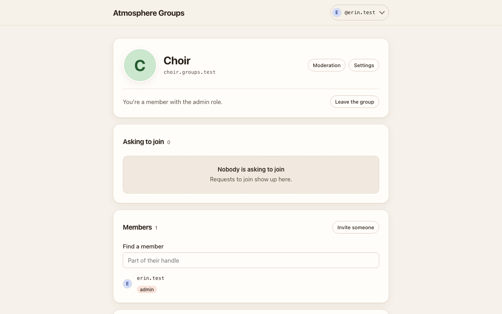
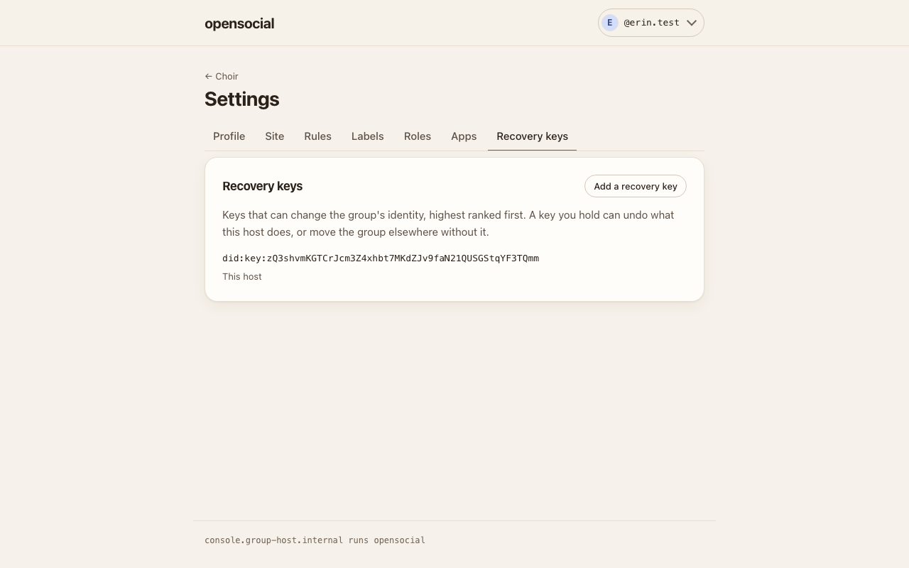
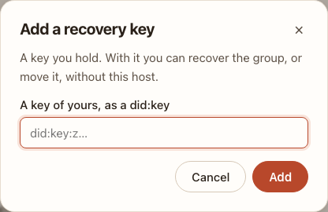
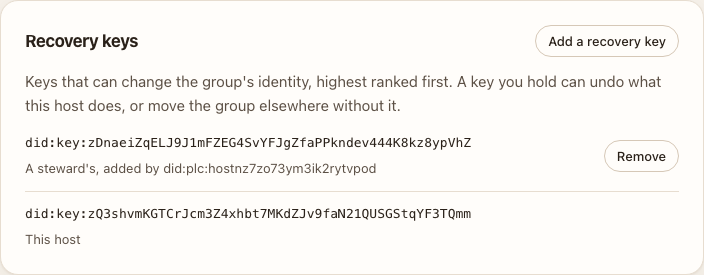
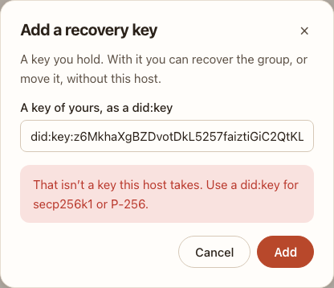
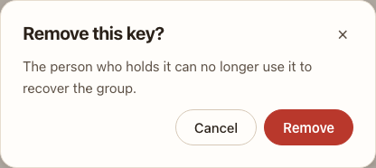
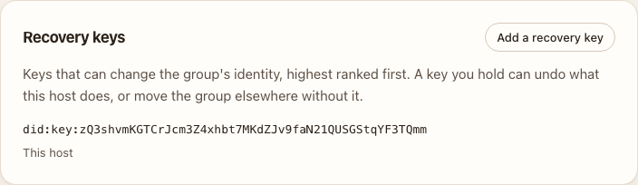

# Adding a recovery key

This guide shows you how to add a recovery key to your group, so you can
take the group back or move it even if this host goes away or goes
wrong.

## Before you begin

You need:

- a group where you have the admin role
- a terminal, to make the key in

## What is a recovery key, and why add one?

A recovery key is a key you hold that can take the group back, or move
it, without this host. Without one, the group has a single key, the
host's. That means only the host can change the group's identity, and
nobody can move the group without it.

A recovery key ranks above the host's. Holding one lets you do two
things:

- Undo a change the host made to the group's identity, within 72 hours
  of it.
- Move the group to another host without this one.

The console only ever sees the public half of your key. The secret half
stays with you, and the host never has it.

You use the key outside the console, and only when you need it. Then you
sign a change to the group's identity with PLC tools, the tools for the
directory that holds it. [How recovery works](../design/recovery.md)
says how, and [moving a group](../design/moving.md) says how a move
goes.

## What do I need first?

1. Open your group's page. If you have no group yet,
   [start one](starting-a-group.md) first. **Settings** is at the top
   right of the group's card.

   <!-- look /new --as erin --type '[name=displayName]=Choir' --press Shift --click 'button:has-text("Start the group")' -->
   

2. Make a key in a terminal. The console doesn't make one for you. One
   way is goat, a command-line tool for the Atmosphere, from Bluesky.
   Get it from
   [github.com/bluesky-social/goat](https://github.com/bluesky-social/goat),
   then run:

   ```sh
   goat key generate
   ```

   It prints two keys, each under a line that names it. The one under
   "Secret Key" is the secret half, which you keep. The one under
   "Public Key" starts `did:key:`. That's the public half, and it's
   what the console asks for.

3. Keep the secret key somewhere safe and offline, such as a password
   manager you trust or paper in a drawer. It's what recovers the group,
   and nobody can make it again if it's lost.

Never paste the secret half into the console, any app, or a chat. Only
the public `did:key:` line goes in.

The console takes keys of two kinds, P-256 and secp256k1. goat makes a
P-256 key unless you ask for another, and that default works. Its public
half starts `did:key:zDnae`.

## How do I add one?

1. On your group's page, press **Settings**. It opens on **Profile**.
2. Press **Recovery keys**. The card lists the group's keys, highest
   ranked first. A new group has one, marked **This host**.

   <!-- look /g/choir.groups.test/settings/recovery --as erin -->
   

3. Press **Add a recovery key**. A dialog opens with one field.

   <!-- look /g/choir.groups.test/settings/recovery --as erin --click 'button[popovertarget=add-key]' --element ':popover-open' -->
   

4. In **A key of yours, as a did:key**, paste your own public key, the
   line that starts `did:key:z...`. The key in the pictures is only an
   example.
5. Press **Add**. The dialog closes, and your key is listed above the
   host's, with **Remove** beside it. The list marks it as a steward's,
   with the DID of the person who added it.

   <!-- look /g/choir.groups.test/settings/recovery --as erin --click 'button[popovertarget=add-key]' --type '#add-key [name=key]=did:key:zDnaeiZqELJ9J1mFZEG4SvYFJgZfaPPkndev444K8kz8ypVhZ' --click '#add-key button[type=submit]' --element 'section.card' -->
   

Only people who can change the group's settings see this tab. In a new
group that's the admin role, and [rules and roles](rules-and-roles.md) says
how to give it to someone. A group can have four recovery keys at most,
besides the host's, so several people who run it can each hold one.

## What if the console refuses it?

The dialog stays open, and the reason shows in a pink box under the
field.

<!-- look /g/choir.groups.test/settings/recovery --as erin --click 'button[popovertarget=add-key]' --type '#add-key [name=key]=did:key:z6MkhaXgBZDvotDkL5257faiztiGiC2QtKLGpbnnEGta2doK' --click '#add-key button[type=submit]' --element ':popover-open' -->


It refuses a key in these cases:

- The key is of a kind the console doesn't take. Make a P-256 or
  secp256k1 key and paste that.
- The key is on the group already, as yours or as the host's.
- Someone else changed the group's keys at the same moment. Press
  **Add** again.

To give up, press **Cancel**.

## How do I see the keys and remove one?

The **Recovery keys** tab always lists them, highest ranked first. The
host's key is last and has no **Remove**.

1. Press **Remove** beside the key. A dialog asks **Remove this key?**

   <!-- look /g/choir.groups.test/settings/recovery --as erin --click 'button[popovertarget=unkey-0]' --element ':popover-open' -->
   

2. Press **Remove**. The key's row is gone from the list.

   <!-- look /g/choir.groups.test/settings/recovery --as erin --click 'button[popovertarget=unkey-0]' --click '#unkey-0 button[type=submit]' --element 'section.card' -->
   

Once a key is removed, the person who holds it can no longer undo the
host's changes or move the group with it. You can add it again later.

## From a terminal

There's no command for recovery keys. You add, see and remove them in
the console. The [CLI reference](../reference/cli.md) lists the commands
there are.

Next:

- [Rules and roles](rules-and-roles.md)
- [Moderating](moderating.md)
- [Signing in as a group](signing-in-as-a-group.md)
