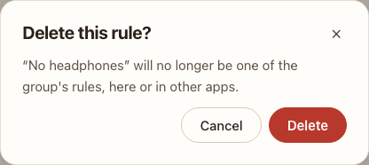
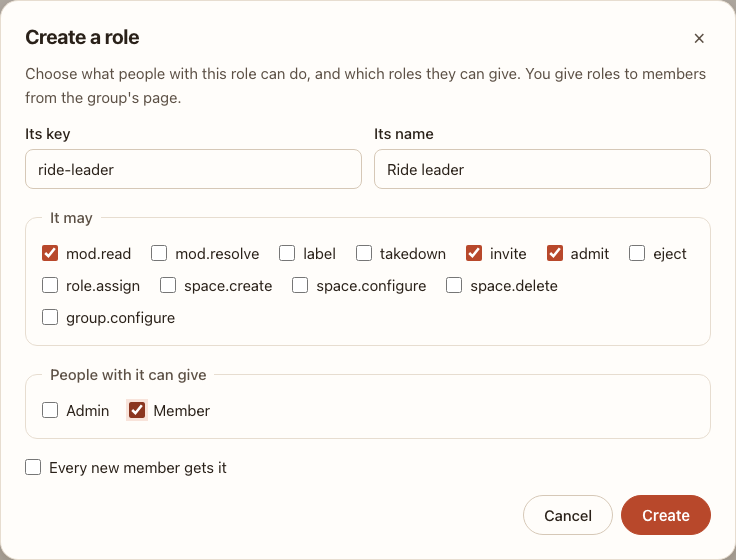
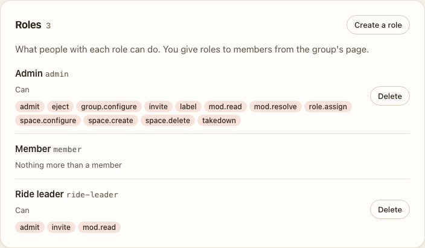
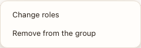

# Rules and roles

This guide shows you how to write your group's rules and give members
roles. Rules tell everyone how the group works. Roles let you share the
running of it, such as letting someone approve new members.

## Before you begin

You need:

- a group where you have the admin role
- at least one other member to give a role to

The examples use Riders, a group with alice, bob and carol in it.

## Where are the group's rules, and who sees them?

1. Open your group's page and press **Settings** at the top right of its
   card.
2. Press the **Rules** tab. A new group has no rules yet, and the card
   says so.

The rules show on the group's page, under its name, in the order on this
tab. Everyone sees them there: members, and people who are not in the
group yet. Only those whose roles let them change the group's settings
see **Settings**. Anyone else who opens the settings is told "Nothing
here is yours to change".

## How do I add a rule?

1. Press **Add a rule**.
2. In **Rule**, type the rule in a few words, such as "Ride with lights
   after dark". It can be 64 characters long.
3. In **What it means**, say more if you like, such as "Front and back
   lights on from sunset, every ride." You can leave it empty.

   <!-- look /g/riders.groups.test/settings/rules --as alice --click 'button[popovertarget=add-rule]' --type '[name=title]=Ride with lights after dark' --type '[name=text]=Front and back lights on from sunset, every ride.' --element ':popover-open' -->
   

4. Press **Add**. The dialog closes and the rule shows last in the list,
   with its number.

Each new rule goes at the end. The console cannot edit a rule or move
one. To change a rule or its place, delete it and add it again.

## How do I delete a rule?

Say you added "Wait at the top" and "No headphones" as well, and no
longer want the last one.

1. Press **Delete** beside the rule. The console asks **Delete this
   rule?** and says the rule will no longer be one of the group's rules,
   here or in other apps.

   <!-- look /g/riders.groups.test/settings/rules --as alice --click 'button[popovertarget=add-rule]' --type '[name=title]=Ride with lights after dark' --type '[name=text]=Front and back lights on from sunset, every ride.' --click ':popover-open button[type=submit]' --click 'button[popovertarget=add-rule]' --type '[name=title]=Wait at the top' --type '[name=text]=Nobody rides on until the last rider is up.' --click ':popover-open button[type=submit]' --click 'button[popovertarget=add-rule]' --type '[name=title]=No headphones' --click ':popover-open button[type=submit]' --click "button[aria-label='Delete “No headphones”']" --element ':popover-open' -->
   

2. Press **Delete**. The rule is gone, and the rules after it move up a
   number.

   <!-- look /g/riders.groups.test/settings/rules --as alice --click "button[aria-label='Delete “No headphones”']" --click ':popover-open button[type=submit]' --element section -->
   

On the group's page, the rules are folded under **Rules** and its count.
A member presses it to read them.

<!-- look /g/riders.groups.test --as carol --seed riders-members --click '.rules summary' --element '.group-card' -->

## What is a role, and what can it let a member do?

A role is a name you give to members, such as "Ride leader", and what it
lets them do. Each thing it lets them do is a permission. Every group
has two roles to start. Admin has every permission. Member is the role
everyone in the group holds, and it adds no permissions.

The **Roles** tab in **Settings** lists the roles and the permissions of
each. They show by their short names:

| Permission | What it lets a member do |
| --- | --- |
| `mod.read` | See what is waiting for moderation. They get **Moderation** on the group's page. |
| `mod.resolve` | Settle what is waiting for moderation. |
| `label` | Put a label on a post or an account. |
| `takedown` | Take something down, anywhere in the group. |
| `invite` | Invite people. They get **Invite someone**. |
| `admit` | Let in people who ask to join. They get **Asking to join**. |
| `eject` | Remove members, with **Remove from the group** in the ⋯ menu on a member's row. |
| `role.assign` | Change members' roles, with **Change roles** in the ⋯ menu on a member's row. |
| `space.create`, `space.configure`, `space.delete` | Make a space (a part of the group with its own say over who reads and writes in it), change who can read and write one, and delete one. |
| `group.configure` | Change the group's settings: its profile, rules, roles, apps and recovery keys. |

A role also says which roles its members can give. That list limits
three things. They can change only the roles on it. They can remove only
members whose roles are all on it. Everyone they let in gets Member, so
a role that admits people needs Member on its list.

## How do I create a role?

1. In **Settings**, press the **Roles** tab, then **Create a role**.
2. In **Its key**, type a short name for the role, such as
   "ride-leader". Use lowercase letters, digits and hyphens.
3. In **Its name**, type the name people see, such as "Ride leader".
4. Under **It may**, tick what the role lets its members do. A ride
   leader here gets `mod.read`, `invite` and `admit`.
5. Under **People with it can give**, tick the roles its members can
   give. Here, **Member**.
6. Tick **Every new member gets it** if everyone let in should have this
   role too.

   <!-- look /g/riders.groups.test/settings/roles --as alice --click 'button[popovertarget=define-role]' --type '#define-role [name=role]=ride-leader' --type '#define-role [name=name]=Ride leader' --click '#define-role input[value=invite]' --click '#define-role input[value=admit]' --click '#define-role input[value="mod.read"]' --click '#define-role input[name=assignable][value=member]' --element ':popover-open' -->
   

7. Press **Create**. The role shows last in the list, with its
   permissions.

   <!-- look /g/riders.groups.test/settings/roles --as alice --click 'button[popovertarget=define-role]' --type '#define-role [name=role]=ride-leader' --type '#define-role [name=name]=Ride leader' --click '#define-role input[value=invite]' --click '#define-role input[value=admit]' --click '#define-role input[value="mod.read"]' --click '#define-role input[name=assignable][value=member]' --click '#define-role button[type=submit]' --element section -->
   

You can give a role only permissions your own roles have. The console
cannot edit a role. To change one, take it off everyone who holds it,
delete it, and create it again.

## How do I give a role to a member?

You give roles on the group's page, a member at a time.

1. Open the group's page. In **Members**, press the ⋯ at the end of the
   member's row. A menu opens.

   <!-- look /g/riders.groups.test --as alice --seed riders-members --click 'li.member:has-text("bob.test") .action-menu summary' --element '.action-menu[open] .menu' -->
   

   Press **Change roles**. A dialog opens, with the roles you can give
   under **Roles you can give**. The dialog lists roles by their keys,
   such as ride-leader, not by their names.
2. Tick the role, here "ride-leader". Leave member ticked. Everyone
   keeps it, and the host turns down a change that leaves it off.

   <!-- look /g/riders.groups.test --as alice --click 'li.member:has-text("bob.test") .action-menu summary' --click 'li.member:has-text("bob.test") .menu button:has-text("Change roles")' --click ':popover-open input[value=ride-leader]' --element ':popover-open' -->
   

3. Press **Save**. The dialog closes, and the role shows as a tag under
   the member's handle.

   <!-- look /g/riders.groups.test --as alice --click 'li.member:has-text("bob.test") .action-menu summary' --click 'li.member:has-text("bob.test") .menu button:has-text("Change roles")' --click ':popover-open input[value=ride-leader]' --click ':popover-open button[type=submit]' --element '.members li:has-text("bob.test")' -->
   

Now bob sees **Moderation**, **Asking to join** and **Invite someone**
on the group's page, and the group's card says they are a member with
the ride-leader role. They get no ⋯ menu on anyone's row, as the role
can neither change roles nor remove members.

## How do I take a role off, or delete it?

1. To take a role off, press the ⋯ on the member's row, then **Change
   roles**, untick the role, and press **Save**. The tag goes from their row.
2. To delete a role, press **Delete** beside it on the **Roles** tab.
   The console asks you to confirm.
3. Press **Delete**. The role goes from the list.

People with a role lose what it lets them do when it goes. You can only
delete a role nobody holds, so take it off everyone first. The host
turns down a delete while anyone holds the role.

## What can't be changed?

Everyone in the group keeps the Member role, and it has no **Delete**.
Admin shows a **Delete**, but you hold Admin, so the host turns it down.
Leave Admin as it is.
You can give and take only the roles your own roles can give, and a role
you make can have only permissions you hold. Only members whose roles
hold `group.configure` can change the rules and roles at all.

## From a terminal

The [`opensocial` command](../reference/cli.md) does each of these:

- Add a rule: `opensocial rule set <group> --title <title> --text
  <words>`. With `--rule <key>` it replaces that rule, and `--order <n>`
  sets its place.
- Delete a rule: `opensocial rule delete <group> <rule>`.
- Create a role: `opensocial role set <group> <role> --display-name
  <name>`, with `--default` if every new member gets it, then
  `opensocial role grant <group> <role> --scopes <permission,…>
  --assignable <role,…>`.
- Give or take roles: `opensocial member assign <group> <member>
  <role,role…>`, naming all the roles they keep, `member` among them.
- Delete a role: `opensocial role delete <group> <role>`.

An AI app connected to the group has the same as
[tools](../reference/mcp.md): `rule_set`, `rule_delete`, `role_set`,
`role_grant`, `member_assign` and `role_delete`.

Next, [moderate the group](moderating.md) with the roles you made. For
why roles and rules work as they do, see
[membership](../design/membership.md) and [groups](../design/groups.md).
