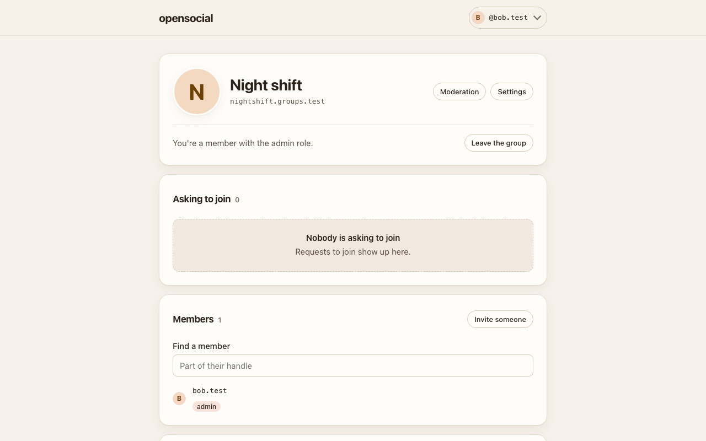
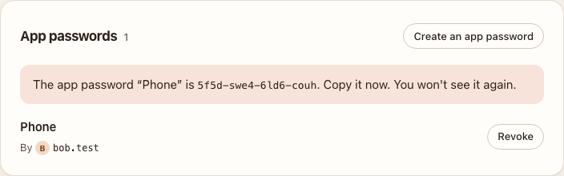
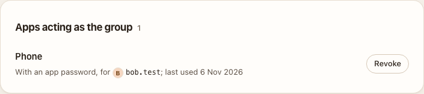
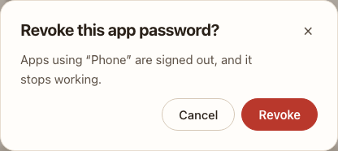

# Signing in as a group in another app

This guide shows you how to let another app post as your group, such as
a bot or a script. A group has no password of its own, so you create an
app password for the app. An app password works for one app, and you
can revoke it at any time without changing anything else.

## Before you begin

You need a group where you have the admin role. If you have none yet,
[start one](starting-a-group.md) first.

## Where do I find the group's apps?

1. Open your group's page. Here it is "Night shift", and you have the
   admin role.

   <!-- look /new --as bob --type '[name=displayName]=Night shift' --type '[name=label]=nightshift' --click 'button:text-is("Start the group")' -->
   

2. Press **Settings**, then the **Apps** tab. It has three cards, empty
   for now: **Apps acting as the group**, **App passwords** and
   **What apps did as the group**.

   <!-- look /g/nightshift.groups.test/settings/apps --as bob -->
   

By default only admins may create app passwords. A member may create
them too if one of their roles may write every collection as the group.
That permission is not among those in
[Rules and roles](rules-and-roles.md), as the console cannot give it.
It is given from a terminal, with `--scopes 'repo:*'` on
`opensocial role grant`. In **Settings**, such a member sees only the
**App passwords** card, with the passwords they made.

## How do I create an app password?

1. Under **App passwords**, press **Create an app password**. A dialog
   opens.

   <!-- look /g/nightshift.groups.test/settings/apps --as bob --click 'button[popovertarget=make-password]' --element ':popover-open' -->
   

2. In **Where it is used**, type a name for the app, such as "Phone". The
   name is only for you, so you can tell your passwords apart.
3. **It may use chat** lets the app use Bluesky's chat as the group.
   This host answers no chat yet, so leave it unticked unless the app
   needs chat.
4. Press **Create**.
5. The password shows once, in a banner above the list. There is no Copy
   button, so select the password and copy it. Keep it somewhere safe.
   The host does not keep it, and you won't see it again. The password
   in the picture is an example; yours will differ.

   <!-- look /g/nightshift.groups.test/settings/apps --as bob --click 'button[popovertarget=make-password]' --type '[name=name]=Phone' --click ':popover-open button:text-is("Create")' --element 'section:has(h2:text-is("App passwords"))' -->
   

Anyone with the password can post as the group. Give it only to an app
you trust. If it leaks, revoke it at once, as
[How do I stop an app?](#how-do-i-stop-an-app) shows.

The password stays yours. It does not expire, but it stops working if you
lose the role that let you make it, or leave the group.

## What do I type into the other app?

In the other app's sign-in, type these three things:

- Server: the address of the console you are using, the one in your
  browser's address bar. The console passes sign-ins on to the host. In
  the Bluesky app this is "Hosting provider", which you change from
  Bluesky Social to a custom one.
- Username: the group's handle, such as "nightshift.groups.test".
- Password: the app password you just copied.

This is not your own handle or your own password. An app password signs
an app in only as the group. A wrong password, or a handle that is not a
group on this host, is turned down.

## What can the app do as the group?

The app can write the group's own records: post as the group, delete its
posts, upload pictures, like and follow, and change the group's profile.
It cannot write to anyone else's account, and it cannot see or change
what the group keeps only for its members.

The host does not serve feeds. If you sign the Bluesky app in as the
group, its timeline will look empty or broken. Posting still works. So
the app is for posting as the group, as a bot or a script does.

## Where do I see what the app does?

1. Open **Settings** and **Apps** again. Under
   **Apps acting as the group**, each app signed in as the group has a
   row, named for the password it used, with the member it is for and
   when it was last used.

   <!-- look /g/nightshift.groups.test/settings/apps --as bob --seed nightshift-apps --element 'section:has(h2:text-is("Apps acting as the group"))' -->
   

2. Under **What apps did as the group**, each thing an app wrote as the
   group is listed, newest first, with the member whose password it used.

   <!-- look /g/nightshift.groups.test/settings/apps --as bob --element 'section:has(h2:text-is("What apps did as the group"))' -->
   

Only writes are listed, not reads. The list stays after you revoke an
app or its password, so you can still see what it did.

## How do I stop an app?

You can end one app's sign-in, or revoke the password itself.

1. To sign an app out, press **Revoke** on its row under
   **Apps acting as the group**, then **Revoke** in the dialog.

   <!-- look /g/nightshift.groups.test/settings/apps --as bob --click 'button[popovertarget=revoke-0]' --element ':popover-open' -->
   

   The app is signed out at once. The password still works, so an app
   that kept it, as a script does, can sign in again.

2. To stop the password for good, press **Revoke** on its row under
   **App passwords**, then **Revoke** in the dialog.

   <!-- look /g/nightshift.groups.test/settings/apps --as bob --click 'button[popovertarget=unpassword-0]' --element ':popover-open' -->
   

   Every app signed in with it is signed out, and the password no longer
   signs anyone in.

You may revoke the passwords you made. An admin may revoke anyone's.

## From a terminal

There is no command for app passwords or for the apps acting as the
group. You make and revoke them in the console. The
[CLI reference](../reference/cli.md) lists the commands there are.

Next, you may want to give members roles in [Rules and roles](rules-and-roles.md),
keep the group's posts in order with [Moderating](moderating.md), or set
up [Recovery keys](recovery-keys.md). [Signing in](../design/signing-in.md)
explains how signing in works.

Connecting an AI app is not the same as signing in as the group. An app
added under **Connect an AI app** on the group's page acts for you, with
what your roles let you do, and needs no app password, as
[AI apps](../design/mcp.md) explains.
