# Starting a group

This guide shows you how to start a group and get it ready for people
to join. You give it a name and an address, say what it is for, and add
a picture and a link.

A group is an account of its own, with its own handle, but nobody signs
in to it. The people who run it act for it from their own accounts.
[Why a group is an account](../design/groups.md) says more.

## Before you begin

You need an account in the Atmosphere, Bluesky's network, such as
`@alice.bsky.social`. Starting a group makes you its first admin.

## How do I sign in?

1. Open the console's home page.
2. Press **Sign in**, at the top right or under the heading. A dialog
   opens and asks for your handle.

   <!-- look / --click 'header button[popovertarget=sign-in]' --element ':popover-open' -->
   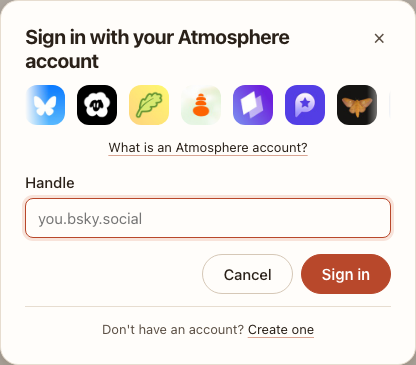

3. Type your handle into **Handle**. Accounts that match show under it as
   you type. Pick yours, or press **Sign in**. The row of icons shows apps
   in the Atmosphere; any of their accounts works here.
4. Your browser goes to the place your account lives. Sign in there, and
   approve the console.
5. You come back signed in. Your handle shows at the top right, and the
   page is headed **Your groups**.

Signing in tells the console who you are, and nothing more: your
password stays with your account. [Signing in](../design/signing-in.md)
says how it works. With no account yet, **Create one** at the foot of the
dialog makes one.

## Where do I start a group?

1. On **Your groups**, press **Start a group**.

   <!-- look / --as alice -->
   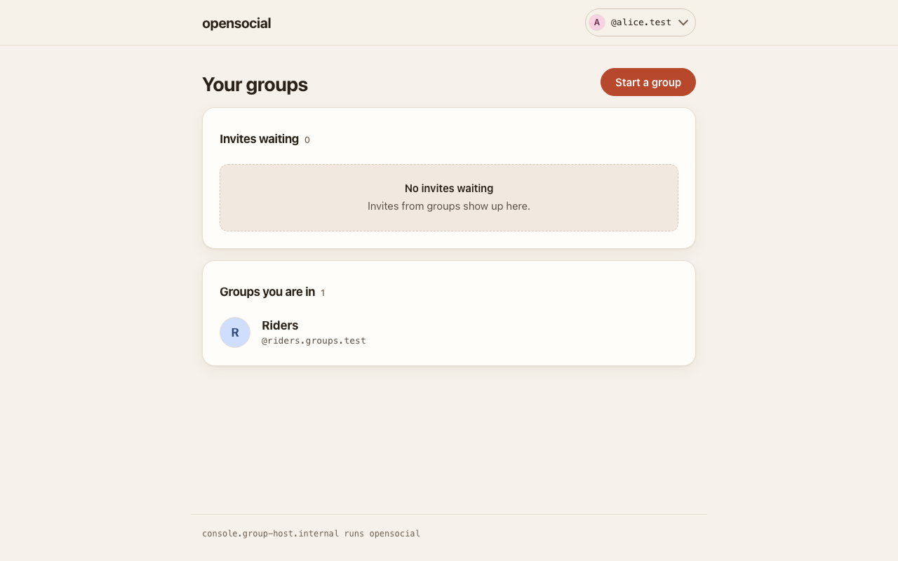

   The form asks for a name, an address, what the group is for, and how
   people join.

   <!-- look /new --as alice -->
   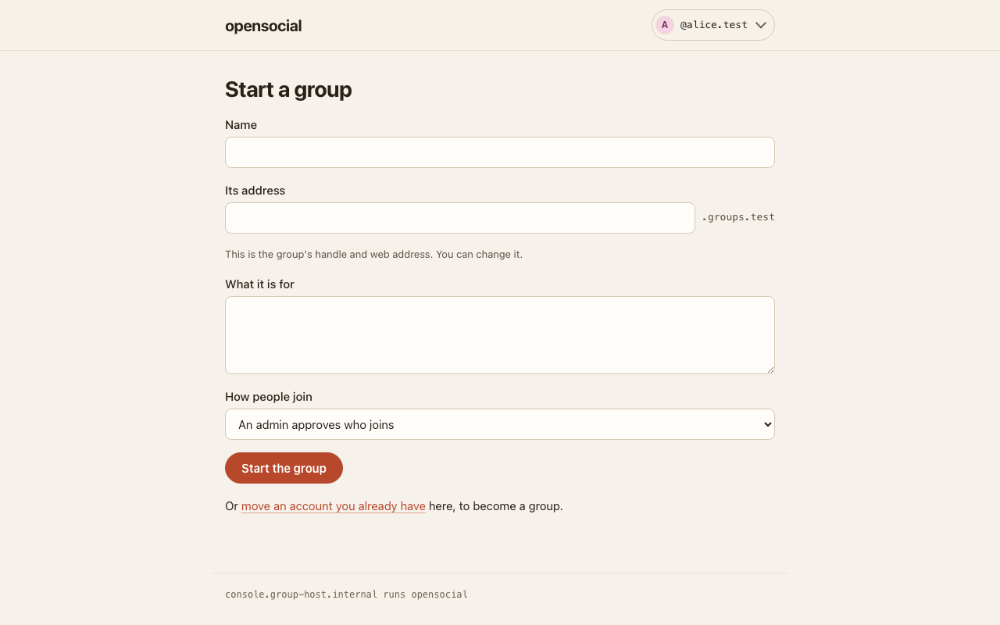

2. Type the group's name into **Name**, such as "Book club". It can be
   up to 64 characters.

## What is the address?

The address is the group's handle and its web address. The part after the
field, such as `.groups.test`, is the host's, and stays the same.

1. **Its address** fills itself in from the name, so "Book club" becomes
   `book-club`. To choose another, type it there, such as `bookclub`.
   Capitals become small letters, and spaces become dashes. Once you
   change it, it stops following the name.
2. Stop typing for a moment, and the console checks that nobody has it.
   If someone does, a band says so under the field, and offers the next
   free address. Here, `riders` was typed, and another group has it.

   <!-- look /new --as alice --type '[name=displayName]=Book club' --type '[name=label]=riders' --press Shift -->
   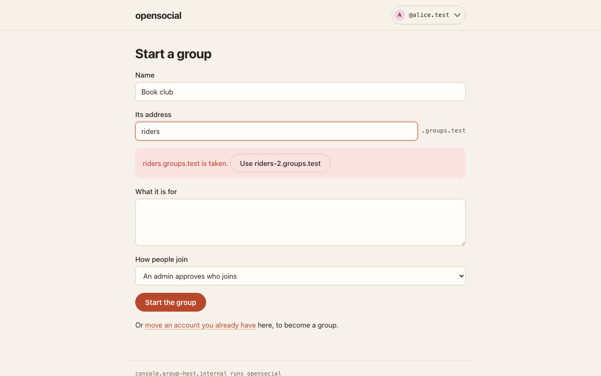

3. Press the button to take the address it offers, such as **Use
   riders-2.groups.test**, or type another.

## Who can join it, and who can see it?

You can leave **What it is for** empty here, and write it later in the
group's settings.

1. Choose from **How people join**: **An admin approves who joins**
   (chosen at first), **Anyone can join right away**, or **Only people
   who are invited**.

Who can see the group is set later, in its settings, on the card **Who
sees it** at the foot of **Profile**. At first it is **Anyone, and it can
be found**. The other choice keeps it for members, and others see just
its handle. How people join can be changed in settings too.

## Start the group

1. Press **Start the group**. If **Name** is empty, the browser asks for
   it first.
2. The group's page opens. Its card says **You're a member with the
   admin role**: a role is a name given to members, and admin lets you
   run the group. The card has the buttons **Moderation** and
   **Settings**. Under it, **Asking to join** lists the people waiting to
   be let in, none yet, and **Members** has you as its one member, with
   **Invite someone** to add more.

<!-- look /new --as alice --type '[name=displayName]=Book club' --type '[name=label]=bookclub' --click 'main form button[type=submit]' -->
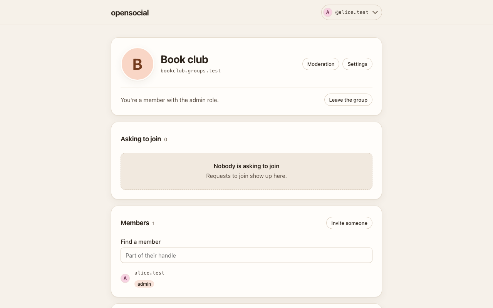

Until it has a picture, the group's avatar is the first letter of its
name. Further down, **Connect an AI app** gives an address to add to an AI
app, so it can act for you in the group with what your roles let you do.

## Write what it is for

1. On the group's card, press **Settings**. It opens on **Profile**, and
   its first card is **About it**.
2. Type into **What it is for**, such as "We read one book a month and
   meet to talk it over."
3. Fill in where it meets if you like: **Town or city it meets in** with
   its **Country**, or **It meets online**.
4. Type into **Topics**, with commas between them, such as "novels,
   reading". It takes up to ten.
5. Fill in **Languages it uses** and **Its own site** if you like.
6. Press **Save**, at the foot of **About it**. **Saved** shows beside
   it once your changes are kept.

<!-- look /g/bookclub.groups.test/settings --as alice --type '[name=description]=We read one book a month and meet to talk it over.' --type '[name=topics]=novels, reading' --click 'form[action="?/profile"] button[type=submit]' -->
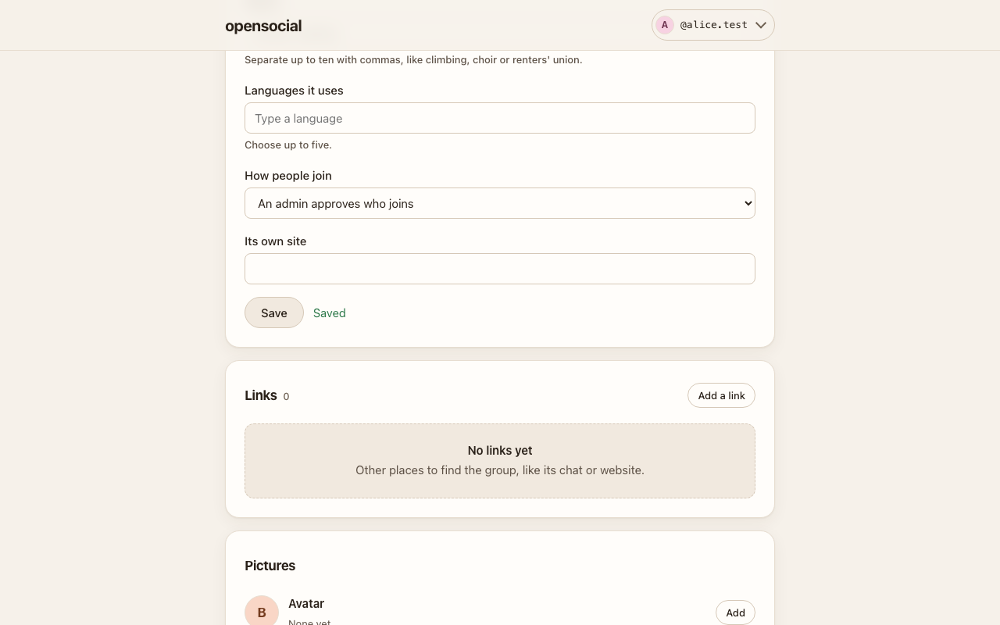

You can change any of this later on the same card.

## Give it a picture

1. Further down, on the card **Pictures**, press **Add** beside
   **Avatar**. The avatar is a square picture, drawn round beside the
   group's name.

   <!-- look /g/bookclub.groups.test/settings --as alice --click 'button[popovertarget=picture-avatar]' --element ':popover-open' -->
   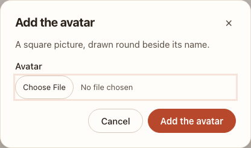

2. Choose a PNG, JPEG or WebP picture, and press **Add the avatar**.
3. Press **Add** beside **Banner**, and do the same. The banner is three times as
   wide as it is high, and runs across the top of the group's page.

Each row now shows its picture, with **Change** and **Remove** beside
it. Removing takes a picture off at once, without asking.

<!-- look /g/bookclub.groups.test/settings --as alice --seed bookclub-pictures --element 'section:has(.pictures)' -->
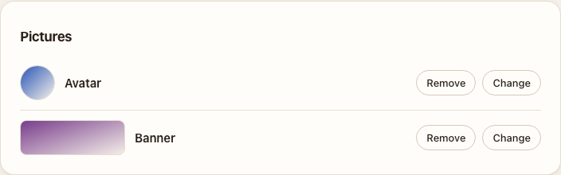

## Add a link

1. On the card **Links**, press **Add a link**.
2. In the dialog, type the link into **Its address**, starting with
   `https://`. This is the web address the link goes to.
3. Type a title for it if you like, such as "Our chat". Without one, the
   link shows as its address.
4. Press **Add**. The dialog closes, and the link is on the card.

<!-- look /g/bookclub.groups.test/settings --as alice --click 'button[popovertarget=add-link]' --type '#add-link [name=url]=https://chat.bookclub.example' --type '#add-link [name=title]=Our chat' --click '#add-link button[type=submit]' --element 'section:has(.link-list)' -->
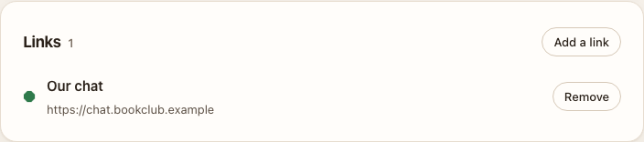

**Remove** beside it takes it off again. A group can have
up to five, shown on its card in the order they were added.

## What does my group look like now?

1. Press **← Book club**, above **Settings**. The card has its banner, its
   avatar, its words, its topics as tags, and its link.

<!-- look /g/bookclub.groups.test --as alice --element '.group-card' -->
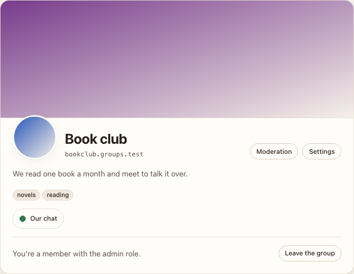

Someone signed in who is not a member sees the same card, without your
standing, **Moderation** or **Settings**. Under it is the way to join
you chose. With people asking to join, they can write in **A note to
them, if you like** and press **Send request**, and the request shows in
**Asking to join** for you to approve.

<!-- look /g/bookclub.groups.test --as bob -->
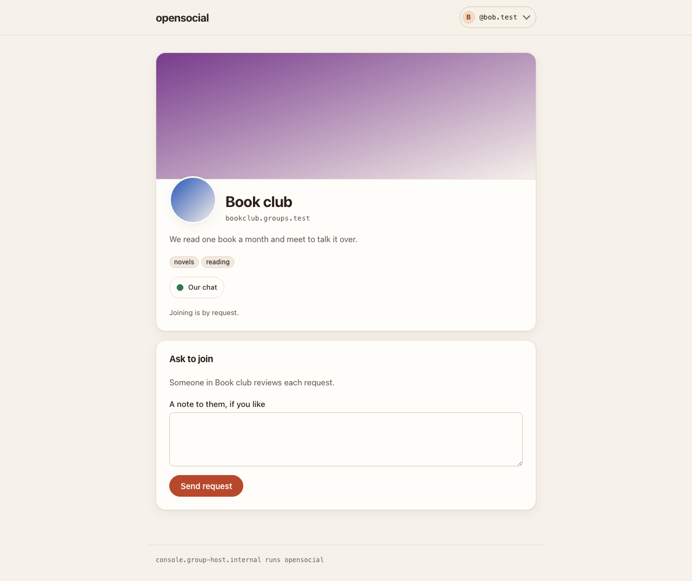

## From a terminal

The `opensocial` command does the same, signed in as the handle in
`OPENSOCIAL_AS`. [Its reference](../reference/cli.md) lists every command.

- Start the group:
  `opensocial group create bookclub.groups.test --display-name "Book club" --join-policy approval`
- See it: `opensocial group show bookclub.groups.test`
- Write what it is for, and its topics:
  `opensocial profile set bookclub.groups.test --description "We read one book a month and meet to talk it over." --topics '[{"topic":"novels"},{"topic":"reading"}]'`
- Set its links, the whole list at once:
  `opensocial profile set bookclub.groups.test --links '[{"url":"https://chat.bookclub.example","title":"Our chat"}]'`

Pictures and **Who sees it** are set in the console only.

Next, invite the people you want in it, as the guide to inviting people
shows. You may also want to write its rules, under **Rules** in its
settings.
